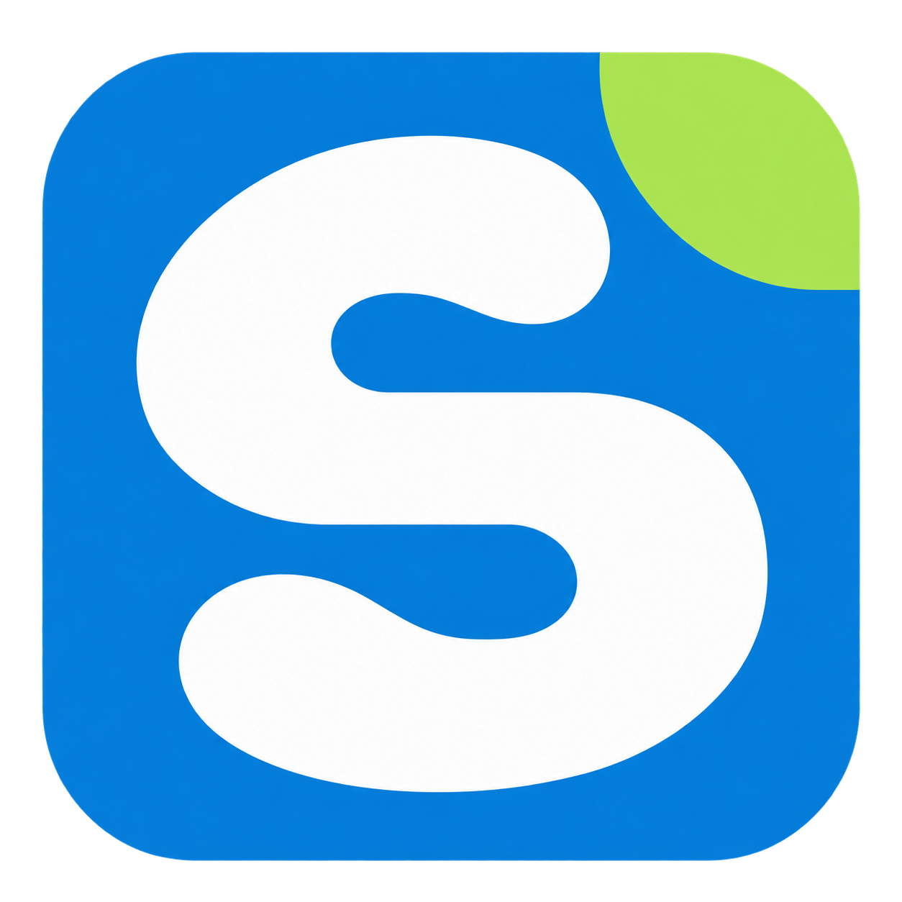
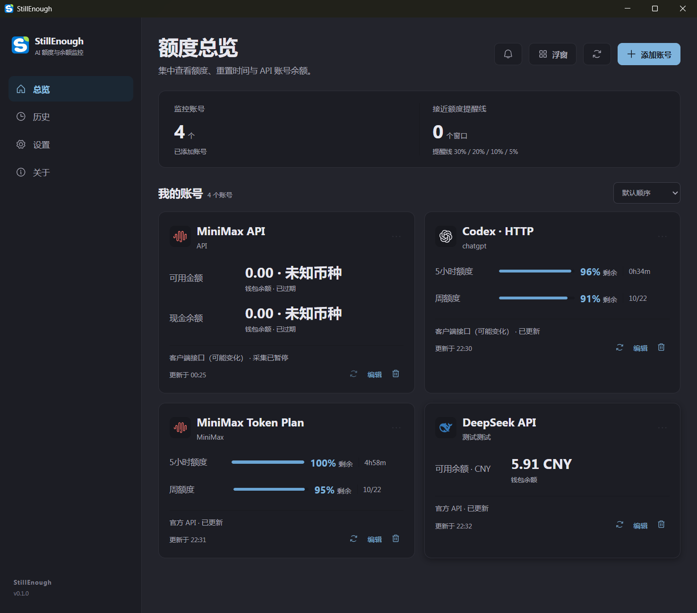
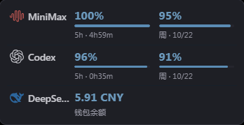

# StillEnough

<p align="center"></p>

**看一眼，安心继续。**

Windows 桌面的 AI 额度与余额监控工具。集中查看多个平台的剩余额度、重置时间和 API 钱包余额，通过托盘与浮窗减少反复打开用量页面的操作。

[下载 Windows 版](https://github.com/com1com4/StillEnough/releases/latest) · [支持的平台](#平台接入状态) · [使用方法](#使用)

## 核心功能

- **多个平台，一个地方查看**：集中管理多个账号，查看订阅剩余额度、各窗口重置时间和 API 钱包余额，减少来回切换平台页面。
- **桌面浮窗，随时看一眼**：将关注账号置顶显示，支持拖动排序、显示 1–8 个账号，自定义别名、进度条、重置时间和透明度，支持闲置淡化、悬停恢复，也可折叠收起。
- **后台自动刷新**：默认每 10 分钟采集，可选 5/10/15/30 分钟；支持手动刷新、全局暂停和单账号停用，遵守平台限流。
- **低额度提醒与历史回看**：订阅剩余额度达到设定阈值时在应用内提醒；查看 7/30 天观测曲线，导出账号与当前指标为 JSON/CSV。
- **真实数据，状态清楚**：额度窗口分别展示，钱包按币种展示；查询失败保留上次数据和时间，未知或过期明确标记，不把缺失值当作满额或零余额。
- **适合日常桌面使用**：托盘常驻、可选开机启动、白天/夜间/跟随系统主题；支持全局及账号级网络设置，API 凭据保存在 Windows 系统凭据库。
- **中英文界面**：在设置中选择跟随系统、简体中文或 English；语言偏好保存在本机，主窗口、浮窗与托盘使用相同设置。
- **CLI / AI Agent 调用**：GUI 与 CLI 随同一个便携包提供；在主窗口授权后查询账号与额度、触发后台刷新，支持 JSON、超时和明确退出码。

当前版本为 0.4.0，处于早期开发阶段。新增浮窗闲置淡化与可调不透明度，精简浮窗操作，并扩展部分平台地区入口，见 [版本说明](docs/releases/v0.4.0.md)。已接入的平台与连接方式见下表；客户端内部接口可能变化，不同套餐、地区的验证范围见平台详情。

## 界面预览

**主窗口总览**：在一个界面查看多平台额度、重置时间与 API 余额，同时区分已更新、已过期和采集暂停的状态。



**桌面浮窗**：将关注账号的剩余额度和余额放在桌面，工作时随时看一眼。



以上为 v0.1.0 实际运行截图。

## 平台接入状态

| 产品 | 接入方式 | 查询内容 | 接入状态 |
|---|---|---|---|
| Codex · HTTP | 授权读取本机 Codex CLI 登录 | ChatGPT 订阅额度窗口及附加池 | 已接入，用户实测读取成功 |
| Claude Code | 授权读取本机 Claude Code 登录 | 订阅额度窗口 | 已接入，真实账号待验证 |
| DeepSeek API | API Key | 按币种的钱包余额 | 已接入，用户实测读取成功 |
| MiniMax API | 对应区域的普通 API Key | 可用金额、现金余额；来源无币种时显示未知 | 已接入，用户实测读取成功 |
| MiniMax Token Plan | 对应区域的套餐 Key | 通用额度池 5 小时/周窗口 | 已接入，用户实测读取成功 |
| 阿里百炼 API | 阿里云 AccessKey ID / Secret | 整个阿里云账号现金余额与可用额度，非百炼专属余额 | 已接入 · 实验性，真实账号待验证 |
| 阿里百炼个人 Token Plan | 授权通过已登录的官方 bl CLI 查询 | 月额度与重置时间 | 已实测读取成功；登录 Token 容易过期，重新登录体验待改善 |

“已接入”表示应用提供连接、测试读取和后台刷新功能。“用户实测读取成功”依据 2026-10-16 的用户反馈，仅代表已使用账号的读取结果，不表示所有套餐、地区或长期运行都已验证。来源与实测记录见 [平台说明](docs/PROVIDERS.md)。

Codex app-server 适配器保留用于已有账号管理，暂不开放新增入口；新增 Codex 账号使用 HTTP 方式。已新增 MiniMax 海外 API/Token Plan、GLM 国内/海外 Coding Plan、Kimi 国内/海外 Code 与 Moonshot API 余额入口，均标为实验性、待真实账号验证。GLM API 钱包缺少可靠查询契约，暂未接入；Gemini、Antigravity 尚未接入。

## 使用

从 [GitHub Releases](https://github.com/com1com4/StillEnough/releases/latest) 下载 Windows x64 ZIP，解压后运行 StillEnough.exe。运行需要 Microsoft Edge WebView2 Runtime；也可从源码启动或自行构建。

1. 启动应用，点击“添加账号”，选择产品。
2. 在本机配置 API 凭据，或明确授权读取所选 CLI 的登录来源。
3. 测试读取并核对账号、额度/金额与重置时间，然后启用保存。
4. 在设置中选择关注账号、浮窗显示与查询网络。

本工具不提供示例账号或演示数据。尚未成功查询时显示暂无数据/未知；订阅额度与 API 钱包余额是不同指标。

## 从源码运行

Windows 10/11 x64 优先。安装 Node.js、项目指定的 pnpm、Rust stable MSVC、Visual Studio C++ Build Tools 和 WebView2。

依赖由两份锁文件固定；pnpm 版本由 package.json 的 packageManager 指定为 11.9.0。此前开发记录使用 Node.js 22.22.2；本轮本地检查使用 Node.js 24.21.0、Rust/Cargo 1.95.0。这是开发验证记录，不代表最低兼容版本。干净 Windows 安装仍待验证。

在克隆后的项目根目录打开 PowerShell：

```powershell
pnpm install --frozen-lockfile
pnpm tauri dev
```

pnpm dev 只启动前端服务器；账号、凭据和查询需要桌面 Rust 后台。

## 检查与构建

```powershell
pnpm version:check
pnpm typecheck
pnpm lint
pnpm test
pnpm build
cargo fmt --all -- --check
cargo check --workspace --locked
cargo clippy --workspace --all-targets --locked -- -D warnings
cargo test --workspace --locked
```

前端测试包含版本脚本、历史分段、展示、主题和浮窗排序；Rust 测试覆盖解析、错误处理、迁移、告警与状态管理。真实账号和 Windows 交互另行验证。

先从托盘退出已运行的程序，再构建：

```powershell
pnpm desktop:bundle -Bundle none
powershell -NoProfile -File scripts/package-portable.ps1
```

可执行文件为 target/release/stillenough.exe 和 target/release/stillenough-cli.exe，发布时一起放入便携 ZIP。当前不发布安装程序。pnpm build 只构建前端。版本升级见 [版本管理](docs/VERSIONING.md)。

## 数据与隐私

账号配置、设置、观测历史保存在本机 SQLite；API 凭据保存在 Windows 系统凭据库。CLI 来源仅在用户授权后读取，不改写其他 CLI 的登录文件，不使用其 refresh token 刷新登录。

查询连接相应平台，并按所选网络策略使用代理。导出排除凭据、认证路径和原始响应，但别名、观测值及时间仍可能属于个人信息，分享前请检查。

## 已知限制

- 客户端内部接口可能改变或拒绝第三方访问；fixture 不能代替真实账号验证。
- 默认 CLI 登录来源不提供独立多账号隔离，切换 CLI 账号后需重新核对。
- 提醒目前仅在应用内显示，尚无 Windows 系统通知。
- PAC 和带认证的代理未受支持；百炼 CLI 仅使用自身环境，详见平台说明。
- macOS/Linux、干净 Windows 安装、多屏/DPI、睡眠恢复与新版浮窗拖拽仍需验证。

## 文档与贡献

[产品范围](docs/PRODUCT.md) · [架构](docs/ARCHITECTURE.md) · [平台说明](docs/PROVIDERS.md) · [当前待办](TASKS.md) · [贡献指南](CONTRIBUTING.md) · [安全说明](SECURITY.md)

提交问题请提供版本、产品、复现步骤和脱敏错误码；不要上传 Key、Token、Cookie、认证文件、数据库或未脱敏日志。

## 许可与致谢

源码采用 [MIT License](LICENSE)。第三方图标及依赖保留各自许可，见 [第三方声明](THIRD_PARTY_NOTICES.md)。

平台适配参考官方公开资料与 CodexBar 的接口研究，具体固定提交见适配器文档。本项目为独立工具，不代表平台官方产品或合作关系。

## CLI / AI Agent

在主窗口“设置 → CLI / AI Agent 访问”开启权限后，可从 PowerShell 或 Agent 查询：

```powershell
.\stillenough-cli.exe accounts list --json
.\stillenough-cli.exe quota --json
.\stillenough-cli.exe refresh --all --json
.\stillenough-cli.exe doctor --json
```

version/providers 无需桌面或授权。账号查询优先调用桌面命名管道；端点不存在时仅回退已授权只读缓存。刷新共用桌面后台，CLI 不读取凭据或直接联网。支持 --offline、--require-fresh、--timeout；旧值不补额，钱包不计算百分比。详见 [CLI 使用说明](docs/CLI.md)、[实施与验证记录](docs/CLI-IMPLEMENTATION.md)。

GUI 与 CLI 随同一个便携 ZIP 发布，解压后分别运行；真实刷新需要桌面后台，CLI 不会自动启动第二个后台。CLI 本身不需要 Node/WebView2；桌面需要 WebView2，两者的 VC 运行库依赖在干净 Windows 上仍待验证。源码调用可用 `pnpm cli -- quota --json`，`pnpm desktop:bundle -Bundle none` 编译两个 EXE。本地 CLI ZIP/npm 打包脚本保留供开发使用，不作为当前正式发布渠道；未发布公共 npm 包，未修改系统 PATH。
